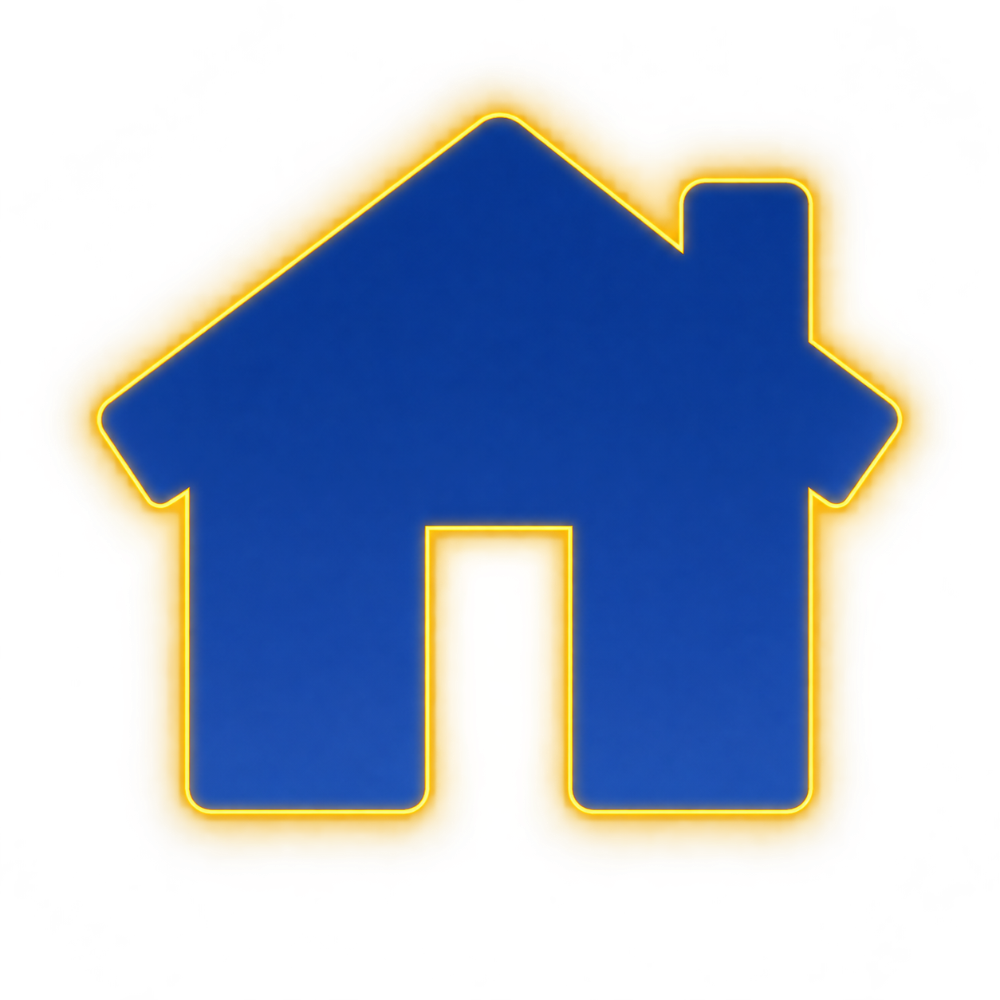

<p align="center">
  
</p>

# StartPage-for-Playnite-Enhance

<p align="center">
  <a href="https://github.com/Santodan/StartPage-for-Playnite-Enhance/releases"></a>
  <a href="https://github.com/JosefNemec/PlayniteSDK"></a>
  <a href="https://github.com/Santodan/StartPage-for-Playnite-Enhance/releases"></a>
  <a href="https://github.com/Santodan/StartPage-for-Playnite-Enhance/releases"></a>
    <a href="https://github.com/Santodan/StartPage-for-Playnite-Enhance/stargazers"></a>
</p>

> **Disclaimer:** I'm not a developer. All changes and enhancements in this fork were made using AI, I'm just a troubleshooting guy that try to test everything as much as possible. The original StartPage extension and SDK remain credited to felixkmh.

Build your own Playnite desktop dashboard with configurable pages, game shelves, widgets, statistics and charts. This fork extends [StartPage by felixkmh](https://github.com/felixkmh/StartPage-for-Playnite), retaining its layout system and support for external widget providers.

[Roadmap](CUSTOMIZATION-ROADMAP.md) - [Report a bug](https://github.com/Santodan/StartPage-for-Playnite-Enhance/issues/new) - [Suggest a feature](https://github.com/Santodan/StartPage-for-Playnite-Enhance/issues) - [Releases](https://github.com/Santodan/StartPage-for-Playnite-Enhance/releases)

## Install or move from the original StartPage

1. Download the experimental `.pext` package from [Releases](https://github.com/Santodan/StartPage-for-Playnite-Enhance/releases). For a local build, use `source/StartPage/bin/santodan_StartPage_Enhanced_Plugin_0_14_0.pext`.
2. Disable the original StartPage before enabling this fork. **They must not run together:** the shared runtime identity preserves settings and external widget compatibility.
3. Open the `.pext` with Playnite and restart when prompted.
4. Open StartPage from Playnite's sidebar. Enter Edit Mode from the dashboard's background menu to split panels and add widgets.

The fork has its own package ID, `santodan_StartPage_Enhanced_Plugin`. It keeps the original runtime GUID and public StartPage SDK interfaces, so your original configuration may already be available. Do not delete the original settings data when switching.

To recover an earlier configuration, open **Add-ons --> Extension settings --> StartPage-for-Playnite-Enhance --> Import from original StartPage**, choose the original `config.json`, and save settings. The import becomes a saved dashboard profile; it does not replace your current pages. Open **Dashboard profiles...** from the dashboard background menu to use it.

See [fork identity, import scope and compatibility](docs/FORK-IDENTITY.md) for the details. This extension targets Playnite's desktop interface and SDK API 6.1.0.

## What you can customize

| Area | Features |
| --- | --- |
| Dashboard layout | Split panels, resize widgets, arrange multiple named pages and give each page its own background. |
| Widget appearance | Backgrounds, opacity, borders, corners, spacing, shadows, titles, text and supported content colors, with color pickers and theme defaults. |
| Game shelves | Cover rows, grids, compact lists and wide cards; sorting, grouping, include/exclude filters and advanced wildcard rules. |
| Shelf metadata | Titles, source icons, playtime, last played, favorites, installation status and achievement progress, including artwork overlays. |
| Shelf interactions | Dock magnification, zoom, lift, tilt, bounce, glow and dimming; animation direction and optional details popups. |
| Toolbar | Native Playnite and extension items, page navigation, labels, configurable groups, alignment and group appearance. |
| Clock, text and images | Configurable clock/date formats, text styling, image sizing and optional links. |
| Featured game | Selected, hovered, pinned or automatically chosen game, with artwork, formatted description, activity and actions. |
| Game detail widgets | Independent artwork, title, description, activity, details, library information, scores, links and actions, synchronized to the same game. |
| Library statistics | Library totals, playtime, progress, metadata coverage and source/platform breakdowns; per-counter layout, text and colors. |
| Library charts | Multiple bar, vertical bar, pie and doughnut charts with configurable data, size, rotation, legends, labels and segment borders. |
| Transitions | Fade, slide, zoom, wipe and custom presets with previews and JSON import/export. |
| Profiles | Save, import, export, append or restore complete dashboards, with independent snapshots and automatic backups when applying. |

Some data depends on other extensions. Weekly Activity, Most Played and period playtime statistics use **GameActivity** history. Achievement widgets and progress use the achievement provider selected in settings, with data supplied by that provider. Playtime charts grouped by source use Playnite's recorded lifetime playtime.

## Start with a profile

Right-click the dashboard background, choose **Dashboard profiles...**, then expand **Starter profiles**.

| Profile | Layout |
| --- | --- |
| Minimal | Clock, welcome note and a dock-style recently played shelf. |
| Achievements | Recent unlocks and game cards with achievement progress and trophy metadata. |
| Library | Overview counters and recent/favorite shelves, plus a separate Backlog page. |
| Game spotlight | A featured game follows hover/selection, with a dock-style shelf below it. |
| Game inspector | Separate artwork, title, full description with images, activity and actions follow the same game. |
| Library insights | Library and period playtime counters beside source and installation charts. |

Each profile includes navigation and can be customized afterward. **Add profile** saves a copy without changing the current dashboard. The add-pages option lets you try a profile alongside existing pages. Refreshing the starter gallery does not overwrite your saved profiles.

## Roadmap

The [full customization roadmap](CUSTOMIZATION-ROADMAP.md) tracks implemented features and planned work.

Implemented areas include widget appearance, shelf customization, dashboard pages and profiles, transitions, featured/selected-game widgets, library statistics and charts.

Planned areas include:

- Achievement dashboards with completion tracking and goals.
- Shortcut widgets for games, applications, folders and websites.
- Divider and spacer widgets.
- More achievement display settings.
- More background controls.

Priorities may change based on experimental-release feedback. There are no release dates promised for individual items.

## Guides

- [Dashboard pages and toolbar](docs/DASHBOARD-PAGES.md)
- [Dashboard profiles and starter templates](docs/DASHBOARD-PROFILES.md)
- [Shelf patterns and typed filter selection](docs/SHELF-PATTERNS.md)
- [Shelf hover effects](docs/SHELF-HOVER-EFFECTS.md)
- [Featured game](docs/FEATURED-GAME.md)
- [Selected/hovered game detail widgets](docs/GAME-DETAIL-WIDGETS.md)
- [Library statistics and counter definitions](docs/LIBRARY-STATISTICS.md)
- [Transitions and custom JSON presets](docs/TRANSITION-PRESETS.md)
- [Fork compatibility and original-settings import](docs/FORK-IDENTITY.md)

## Feedback and troubleshooting

When reporting an issue, include:

- Extension and Playnite versions, plus your theme.
- Steps to reproduce, expected behavior and actual behavior.
- Relevant widget/profile settings, a screenshot or a short recording.
- A debug log for crashes, slow loading or refresh problems, when available.

Enable **Extension settings > Debug > Enable StartPage debug logging**, reproduce the issue, then click **Open log folder**. Disable logging when finished. To capture startup, enable it before restarting Playnite.

The log is `startpage-debug.log` inside:

```text
<Playnite ExtensionsDataPath>/a6a3dcf6-9bfe-426c-afb0-9f49409ae0c5/diagnostics/
```

Portable installations normally keep `ExtensionsData` under the Playnite directory. Logs rotate at 4 MiB and keep one previous file. Review logs and screenshots before sharing them, since they can contain game names or local paths.

## External widgets and attribution

Compatible extensions can provide widgets through the original StartPage SDK. Keep their providers installed and enabled. A missing provider cannot be restored by importing a dashboard profile. See the [original SDK integration guide](https://github.com/felixkmh/StartPage-for-Playnite/wiki/Integrating-with-other-Extensions); compatibility with every third-party provider is not guaranteed.

Original StartPage and SDK work by **felixkmh**; fork enhancements maintained by **Santodan**. The original attribution is retained under the [MIT license](LICENSE).
